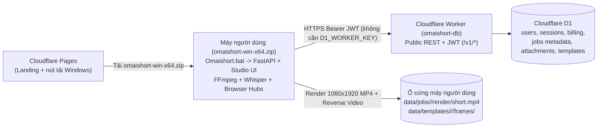

# Tài liệu bàn giao hệ thống — omaishort

## 1. Kiến trúc tổng thể (Cloud D1 + Local Desktop Engine)

Hệ thống tách biệt rõ **dữ liệu tài khoản/nghiệp vụ trên Cloudflare** và **xử lý video nặng trên máy người dùng** để đạt chi phí server gần như **0đ** mà vẫn quản lý tập trung toàn bộ người dùng, gói cước, tín dụng và lịch sử dựng video:



### Bản đồ dữ liệu (Cloudflare D1 vs Ổ cứng máy user)

| Dữ liệu | Lưu trên Cloudflare D1 | Lưu trên máy user | Ghi chú |
| --- | :---: | :---: | --- |
| Tài khoản, mật khẩu (`scrypt`), phiên đăng nhập (`refresh_tokens`) | Có | Không | Đăng nhập 1 tài khoản trên nhiều máy |
| Gói cước (`plans`), hạn dùng (`subscriptions`), lịch sử trừ/hoàn credit (`credit_ledger`), đơn chuyển khoản (`payment_orders`) | Có | Không | Chống sửa credit ở máy client |
| Quản trị (`settings`: giao diện `site_theme`, đóng/mở đăng ký, khoá user, duyệt đơn) | Có | Không | Chỉ `role=operator` có quyền |
| Metadata Job (`input_json`, `bible_json`, `structure_json`, `storyboard_json`, `timeline_json`, `status`, `stage`) | Có | Cache cục bộ | Xem lại kịch bản/storyboard trên mọi máy |
| File gắn kèm nhỏ (`face`, `location`, `prop`, `logo` ≤ 600KB) | Có (`content_b64`) | Tự khôi phục về `data/attachments/` | Dùng lại được trên máy khác |
| Bản vẽ dịch ngược video mẫu (`blueprint.json`, `VIDEO.md`) | Có (`templates`) | Có (`data/templates/`) | Ảnh keyframe & MP4 mẫu giữ cục bộ |
| **Video MP4 thành phẩm, ảnh still lớn, audio VO, file video mẫu gốc** | **Không** | **Có (`data/jobs/`)** | Không tốn dung lượng hay băng thông server |

---

## 2. Bảo mật khi phát hành cho người dùng cuối

- Gói `omaishort-win-x64.zip` **không bao giờ chứa** `.env` của dev, `D1_WORKER_KEY`, `AUTH_SECRET`, hay `data/`.
- Bản phát hành chỉ chứa duy nhất URL công khai `CLOUD_API_URL` (vd `https://omaishort-db.<subdomain>.workers.dev`).
- Mọi thao tác trên `/v1/*` đều xác thực bằng **HS256 JWT** ký bằng `AUTH_SECRET` nằm kín trong **Cloudflare Worker Secrets**, và kiểm tra chặt `user_id` (user chỉ đọc/ghi dữ liệu của chính mình; admin endpoints yêu cầu `role === "operator"`).
- Endpoint SQL thô `/query` và `/batch` vẫn khóa chặt bằng `APP_KEY` (`D1_WORKER_KEY`) dành riêng cho vận hành nội bộ.

---

## 3. Hướng dẫn triển khai bàn giao (3 bước)

### Bước 1: Deploy Cloudflare Worker + D1 (`apps/cloud`)
Chạy script 1 lệnh trên máy có tài khoản Cloudflare (hoặc để GitHub Actions `cd-cloud.yml` tự chạy khi push lên `main`):

```powershell
# Chạy lần đầu (gồm tạo/cập nhật bảng templates trên D1 + nhập AUTH_SECRET + deploy Worker)
.\scripts\deploy_cloud.ps1 -SetAuthSecret
```

Kiểm tra sống: mở `https://omaishort-db.<subdomain>.workers.dev/v1/health` → trả về `{"ok":true,"service":"omaishort-cloud","version":"v1"}`.

### Bước 2: Cấu hình GitHub Repository Secrets & Variables
Trong **GitHub Repo → Settings → Secrets and variables → Actions**:

| Loại | Tên | Giá trị |
| --- | --- | --- |
| **Secret** | `CLOUDFLARE_API_TOKEN` | Token có quyền Cloudflare Pages Edit + Workers Scripts Edit + D1 Edit |
| **Secret** | `CLOUDFLARE_ACCOUNT_ID` | Account ID trên Cloudflare Dashboard |
| **Variable** | `OMAISHORT_CLOUD_API_URL` | URL công khai của Worker (vd `https://omaishort-db.<subdomain>.workers.dev`) |

### Bước 3: Phát hành bản cài đặt Windows cho người dùng cuối
- **Tự động trên GitHub Actions:** tạo tag phiên bản (vd `git tag v0.2.0 && git push origin v0.2.0`) hoặc vào **Actions → `release-desktop` → Run workflow**.
  - Workflow tự build `omaishort-win-x64.zip` đã gắn sẵn `OMAISHORT_CLOUD_API_URL` (không chứa secret) và đăng lên **GitHub Releases**.
  - Nút **Tải cho Windows (.zip)** trên trang Cloudflare Pages tự động tải bản mới nhất.
- **Hoặc build thủ công trên máy Windows:**
  ```powershell
  .\scripts\build_portable_windows.ps1 -CloudApiUrl "https://omaishort-db.<subdomain>.workers.dev"
  ```
  → Sản phẩm tại `dist\omaishort-win-x64.zip` + `dist\SHA256SUMS.txt`.

---

## 4. Hướng dẫn cho người dùng cuối (máy bất kỳ)

1. Tải `omaishort-win-x64.zip` từ trang chủ và **giải nén** ra một thư mục (vd `C:\omaishort\`).
2. Bấm đúp **`Omaishort.bat`** (không cần cài Python, Node, FFmpeg hay PostgreSQL).
3. Cửa sổ Studio tự mở tại `http://127.0.0.1:8765/work`.
4. **Đăng ký / Đăng nhập:** tài khoản, gói dùng thử (3 credit) và lịch sử job tự đồng bộ lên Cloudflare D1.
5. **Tạo video:** chọn **Drama / News / Kiến thức** → dán kịch bản hoặc URL (có thể tải 1 video mẫu vào mục **Dịch ngược video mẫu** để bóc nhịp cắt & tạo `VIDEO.md` rồi áp dụng) → bấm tạo video → tải MP4 1080×1920 lưu ngay trên máy.

---

## 5. Checklist nghiệm thu bàn giao

- [ ] `node --test apps/cloud/test_worker.mjs` — pass toàn bộ (xác thực JWT, cách ly dữ liệu user, trừ/hoàn credit, duyệt đơn, template sync, chặn `/query` không key).
- [ ] `apps\api\.venv\Scripts\python.exe -m pytest -q` — pass toàn bộ (gồm `test_cloud_mode.py`, `test_video_reverse.py`, `test_desktop.py`, `test_billing.py`, `test_full_flow_e2e.py`).
- [ ] `cd apps/web && npm run build` — sạch TypeScript & Vite build.
- [ ] Mở `https://<worker-url>/v1/health` trả `200 OK`.
- [ ] Cài `omaishort-win-x64.zip` trên 1 máy Windows sạch → bấm `Omaishort.bat` → đăng ký user mới → kiểm tra user & job metadata xuất hiện trong Admin Console (Cloudflare D1), file MP4 nằm trong `data/jobs/<id>/render/short.mp4`.
