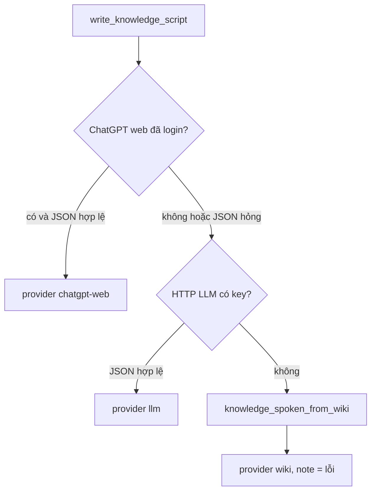

# 2.6 Quy trình Prompt (Prompt Workflow)

> Nguồn: `complete_json_result` trong `providers/llm.py`, `write_knowledge_script` trong `engine/analyzer.py`.

Một job tin/kiến thức không có một prompt duy nhất sống sót mọi lỗi. Thứ tự:

`complete_json_result` trả `(json, provider, error)`. Provider rỗng khi cả hai đường đều trượt. `write_knowledge_script` khi đó gọi `knowledge_spoken_from_wiki` và ghi provider `wiki` (hoặc `github` nếu extract là README). Pipeline ghi cả ba vào `data/jobs/<id>/script.json`: `text`, `provider`, `note`.

Analyze drama/news dùng `analyze_story`: LLM JSON hợp lệ thì provider `llm`; lỗi validate hoặc không có JSON thì `fallback_analyze`, provider `fallback`. Hàm `analyze_story` gọi `complete_json` (nuốt tên provider). Tên `chatgpt-web` hiện rõ ở **script**, không phải lúc nào cũng hiện ở bước analyze.

Đây là workflow sản phẩm: prompt → parse → từ chối bản xấu → fallback có chủ đích. Không có bước "người duyệt prompt" trong API.

Job gara cháy trong lộ trình là ví dụ hallucination / fallback: chưa login ChatGPT nên script là bản chép bài (`provider` = `wiki`), lời nói cháy xe nhưng từ khoá ảnh lệch. Việc sửa từ khoá nằm ở chương 6, không sửa bằng cách nới prompt cho model bịa ảnh.
