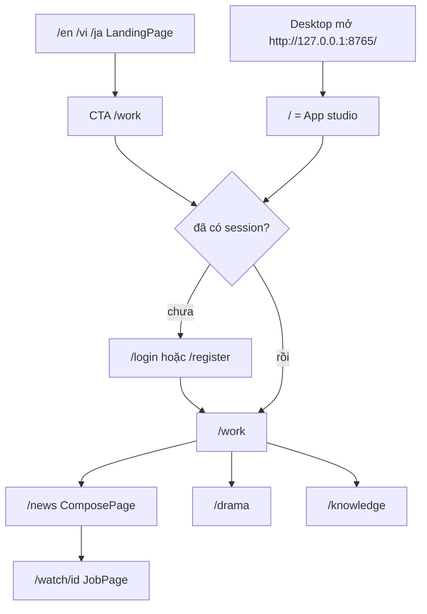

# 4.1 Luồng người dùng (User Flow)

> Nguồn: `apps/web/src/main.tsx`, `apps/web/src/App.tsx`, `apps/web/src/nav.tsx`, `apps/api/omaishort/desktop.py`.

## Việc từng bước làm

| Bước | Route | Code |
| --- | --- | --- |
| Landing đa ngôn ngữ | `/:lang` với `lang` thuộc `vi`, `en`, `ja` | `LandingRoute` trong `main.tsx`. Lang lạ thì `Navigate` về `/work` |
| Vào studio từ landing | Link `/work` ở Hero, Header, CTA | `HeroSection.tsx`, `Header.tsx`, `CTASection.tsx` |
| Chưa đăng nhập | mọi route studio | `App.tsx`: `if (!user && !gate) return <Redirect to="/login" />` |
| Đã đăng nhập mà vào cổng | `/login`, `/register` | redirect `/work` |
| Chọn loại video | `/drama`, `/news`, `/knowledge` | `ComposePage` theo `route.name` |
| Xem job | `/watch/:id` | `JobPage` |
| Tài khoản | `/account` | `AccountPage` |
| Desktop | mở đúng `/` | `desktop.py` `run()` đặt `url = http://{host}:{port}/` rồi `open_studio_window`. `/` map `App`, không map landing |

`/:lang/studio` bị `Navigate` về `/work`. Route lạ (`*`) cũng về `/work`, rồi nếu chưa login thì sang `/login`.

File vẫn trên máy. Poll job đọc `/jobs/{id}` và `/files/...`. D1 (khi bật) chỉ giữ hàng metadata. Xem chương 5.
