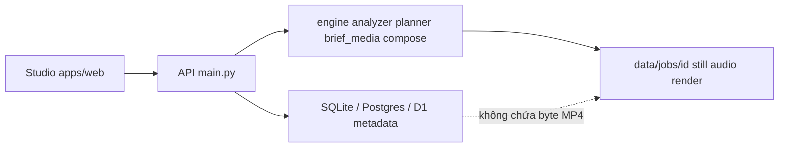

# 5.1 Thiết kế kiến trúc

> Nguồn: `apps/web`, `apps/api/omaishort/main.py`, `pipeline.py`, `engine/`, `db.py`, `d1.py`, `paths.py`.

| Tầng | Chỗ | Giữ gì |
| --- | --- | --- |
| Studio | `apps/web` | Route, form, poll job, hiện still |
| API | `apps/api/omaishort/main.py` | HTTP, auth, tạo job |
| Engine | `engine/analyzer.py`, `planner.py`, `brief_media.py`, `compose.py` | Lời, cảnh, ảnh tin, MP4 |
| Hàng job | `db.py`; Cloudflare D1 khi có `D1_WORKER_URL` + key (`d1.py`) | status, stage, JSON metadata |
| File | `paths.py` → `DATA_DIR/jobs/<id>/` | `stills/`, `audio/voiceover.mp3`, `render/short.mp4`, `render/motion.json`, `script.json` |

D1 nhận SQL qua Worker (`apps/cloud/src/index.js`, POST `/query`, header `x-omaishort-key`). Schema bảng nằm ở `apps/cloud/schema.sql`, cùng bốn bảng với `init_db`. `D1Connection` trong `d1.py` chỉ gửi `sql` và `params`. Byte ảnh và MP4 không đi vào câu SQL đó. Desktop và pytest có thể dùng SQLite; không cấu hình D1 thì `db.py` hướng Postgres local (`_DEFAULT_PG`).

Stage cố định: analyze → plan → refs → stills → tts → captions → render (`pipeline.py`).
