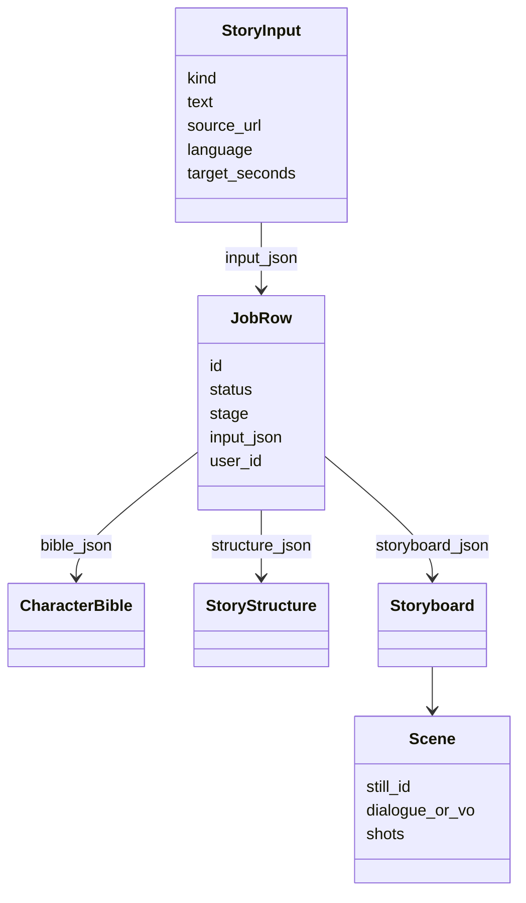

# 5.3 Mô hình hóa hệ thống và UML

Repo không có file `.puml` hay xuất UML. Sơ đồ lớp dưới đây chép quan hệ đang có trong `packages/schema/omaishort_schema/models.py` và bảng SQL.

`VideoKind`: `drama`, `news`, `knowledge`, và `brief` (alias của news). `is_editorial` đúng với news, knowledge, brief.

Use case mức HTTP nằm ở route chương 5.5, không vẽ lại thành biểu đồ sao cho đủ "đẹp UML". Actor thật: Anonymous (vài route công khai), Creator, Operator — đã liệt ở chương 3.1 từ `docs/AUTH.md`.

> ⚠️ Không có sequence diagram check-in cho từng stage. Thứ tự stage là danh sách trong REQUIREMENTS và `pipeline.py`.
